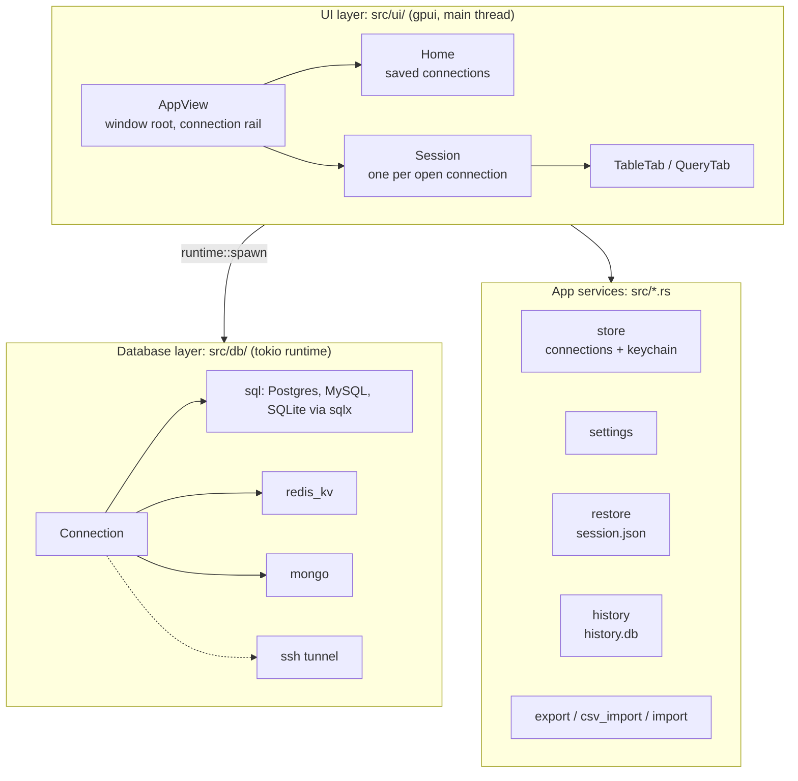
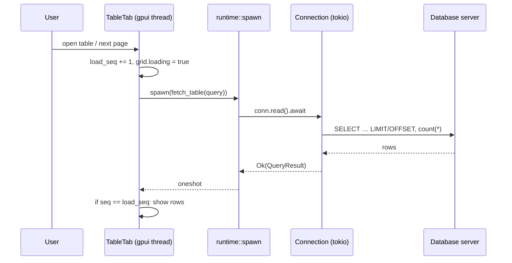

# Architecture overview

Tabula is a single Rust binary (`tabula`) of about 20,000 lines. It has
three layers:



| Layer | Where | Responsibility |
| --- | --- | --- |
| UI | `src/ui/` | Windows, views, dialogs, key bindings. Runs on gpui's main thread. |
| App services | `src/*.rs` | Files Tabula owns (connections, settings, session, history), the keychain, import and export, and the optional MCP server (`mcp.rs`) that AI tools connect to. It runs on the tokio runtime with its own connections, and asks the UI for safe-mode confirmations through a channel (`ui/mcp_service.rs`). |
| Database | `src/db/` | One `Connection` type in front of five drivers, plus everything that understands SQL: splitting, formatting, safety checks, EXPLAIN, DDL. |

## Two executors: gpui and tokio

gpui has its own single-threaded executor for UI work, but the database
drivers (sqlx, redis, mongodb, russh) need **tokio**. Tabula runs both:

- **gpui** owns the main thread. All views (*entities*) live there and are
  `!Send`; they hold `Rc`s and are updated through `Context`.
- **tokio** is a separate multi-threaded runtime with four worker threads
  named `tabula-db`, started lazily in `src/runtime.rs`.

`runtime::spawn(future)` runs a future on tokio and returns a plain future
the UI can await from `cx.spawn`. The result crosses back over a `oneshot`
channel. A panic in database code becomes an ordinary error ("Internal error
(a bug in Tabula): …") instead of taking the app down.



Each view tags its requests (`load_seq` in `TableTab`, `edit_gen` in
`QueryTab`). A result that comes back after a newer request was made is
dropped, so a slow page can't overwrite a newer one.

## Sharing a connection

An open connection is shared by its `Session` and all of that session's tabs
through `ui::Shared`:

```rust
pub struct Shared {
    pub cfg: ConnectionConfig,
    pub conn: Arc<tokio::sync::RwLock<Connection>>,
    pub schema: Rc<RefCell<completion::Schema>>, // names for autocomplete
}
```

Reads, queries and commits take the **read** lock, so they run side by side
(the SQL drivers use a connection pool). Switching database or Postgres
schema takes the **write** lock, because it changes the connection itself.
It waits at most 3 seconds, then asks the user to stop what's running, so a
long query can't freeze the switch and every read queued behind it.

## Everything is text

The database layer returns `QueryResult { columns, rows:
Vec<Vec<Option<String>>> }`: every value is text or `NULL`. The SQL drivers
read through the **text protocol** (`raw_sql`), so every type, including
ones Tabula has never seen, shows as the server prints it. Writes go the other
way through bound parameters. Redis and MongoDB results are turned into the
same shape. This keeps the grid, export, copy and the row panel the same
for all five databases.

## Errors

Nothing that can fail panics. Database calls return `anyhow::Result`, and
errors pick up context on the way up:

- `Connection::explain` adds *"Lost the connection"* or *"the SSH tunnel
  dropped and couldn't be reopened"* when that's the real cause.
- Background reads (sidebar, table pages, structure, process list) time out
  after 30 seconds with a message saying the server may be down or busy.
  Editor queries have no timeout; ⌘. stops them.
- The UI shows errors as notifications or inline in the tab. Files that
  can't be parsed are moved aside, not overwritten (see
  [Storage](storage.md)).

## Where to go next

- [User interface](ui.md): views, actions, dialogs, editing.
- [Database layer](database.md): drivers, queries, commits, cancel.
- [SSH tunnels](ssh.md), [Storage](storage.md),
  [Safety and security](safety.md).
- [Source files](../modules.md): a description of every file.
