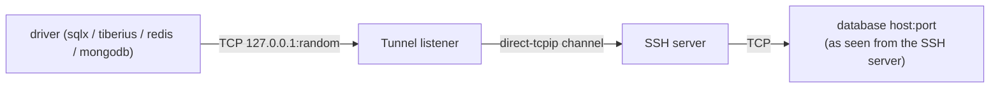

# SSH tunnels

`src/db/ssh.rs` does what `ssh -L` does, inside Tabula. It uses
[russh](https://github.com/Eugeny/russh), a pure-Rust SSH client, with the
`ring` crypto backend, so no `ssh` binary is needed.

## How it works

1. `Tunnel::open` logs in to the SSH server and binds a listener on
   `127.0.0.1` with a random free port.
2. `Connection::connect` copies the connection settings, sets host and port
   to that local port, and connects the driver there as usual.
3. Each TCP connection the driver opens (one per pooled connection) gets
   its own `direct-tcpip` channel over the **one** SSH session, and bytes
   are copied both ways.
4. Dropping the `Connection` drops the `Tunnel`, which aborts the accept
   task, and with it every forward.

SQLite is a local file, so it never uses a tunnel. A MongoDB connection
*string* (`mongodb://…`) can't go through a tunnel, because the driver
would resolve the hosts itself. Enter host and port instead.

## Reopening a dropped session

Laptops sleep, networks change and servers restart. The live session is
kept as `Mutex<Arc<Handle>>`. When the next connection arrives and the
session is closed, it logs in again and replaces it, so the tunnel recovers
by itself. If reopening fails, the reason is kept, and `Tunnel::broken()`
returns it. Database errors then say *"The SSH tunnel through host dropped
and couldn't be reopened (reason). It's retried on the next request"*,
instead of a bare "connection refused".

A keepalive every 30 seconds notices dead sessions early.

## Logging in

| Method | Details |
| --- | --- |
| Password | Stored in the OS keychain under `"{connection id}:ssh"`. |
| Private key | The chosen file (with its passphrase from the keychain), or, with no file chosen, the usual `~/.ssh/id_ed25519`, `id_ecdsa`, `id_rsa`. Default keys that can't be loaded, such as one needing a different passphrase, are skipped. A key file you chose yourself fails with its own error. RSA keys sign with the strongest hash the server supports. |
| ssh-agent | Every key the agent offers is tried. On macOS and Linux the agent is found through `SSH_AUTH_SOCK`. On Windows, Tabula tries the OpenSSH agent pipe (`\\.\pipe\openssh-ssh-agent`), then Pageant. |

Connecting is limited to 15 seconds and login to 60 seconds. The longer
login limit leaves time for an agent that waits for a hardware-key touch.

## Host keys

The server's key is checked before anything is sent:

1. against `~/.ssh/known_hosts` (so hosts you already use with `ssh` just
   work), then against Tabula's own `known_hosts` in its config folder;
2. a **changed** key is always refused, since it may be a
   man-in-the-middle;
3. an **unknown** key fails with `UnknownHostKey`. The UI shows its
   fingerprint and asks *"Trust this SSH host?"*. On OK, `trust()` saves it
   to Tabula's `known_hosts` and the connection is retried.

Tabula never writes to `~/.ssh/known_hosts`.

## Tests

`ssh.rs` includes an in-process SSH server (russh's server side) used by
tests. They check trust-on-request, key-file login, forwarding, and that a
session the server disconnects is reopened.
