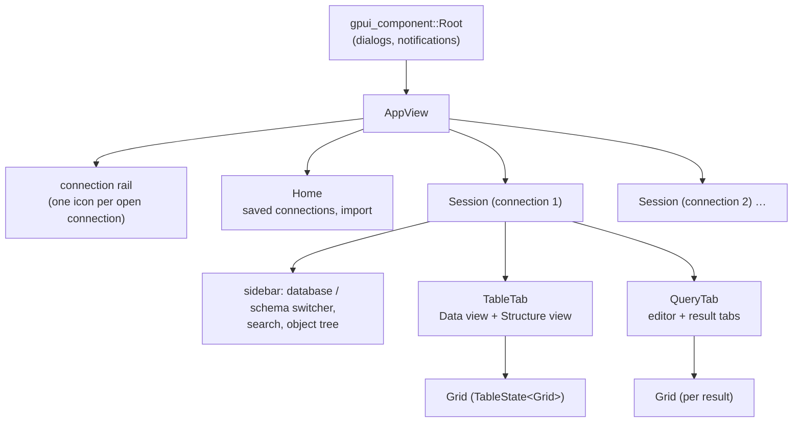

# User interface

The UI is built with [gpui](https://github.com/zed-industries/zed/tree/main/crates/gpui),
the GPU-accelerated framework from the Zed editor, plus
[gpui-component](https://github.com/longbridge/gpui-component) for widgets:
inputs, the code editor, the virtualized table, dialogs, menus and
notifications. All of it lives in `src/ui/`.

## A short gpui primer

- Views are **entities** (`Entity<T>`) owned by the app. A view implements
  `Render` and redraws when it calls `cx.notify()`.
- State changes go through `entity.update(cx, |view, cx| …)`. Updating an
  entity **that is already being updated** panics. Tabula avoids this by
  deferring the work (`window.defer`, `cx.defer`) whenever a callback might
  run inside another update, for example in global shortcut handlers and
  dialog buttons.
- Async work is `cx.spawn(async move |this, cx| …)`; `this` is a weak
  handle, so a view closed in the meantime is simply skipped.
- Elements are rebuilt every frame from `render`. Dialogs are built by a
  closure that runs on every render, so one-time work such as focusing the
  first field runs only on the first call.

## The view tree



| View | File | Role |
| --- | --- | --- |
| `AppView` | `ui/app.rs` | Window root: title bar, connection rail, which session is in front. Opens connections, saves and restores the session, routes shortcuts. |
| `Home` | `ui/home.rs` | Start screen: saved connections (connect, edit, duplicate, delete) and TablePlus import. |
| `ConnForm` | `ui/conn_form.rs` | New / edit connection dialog, with Test and SSH settings. |
| `Session` | `ui/session.rs` | One open connection: sidebar, tab strip, database switching, backup / restore, create / drop database, sidebar menus. |
| `TableTab` | `ui/table_tab.rs` | A table, view, collection or Redis key space: filter bar, editable grid, pager, Structure view, CSV import, foreign-key jumps. |
| `QueryTab` | `ui/query_tab.rs` | Editor, run / stop, one result tab per statement, editable results, EXPLAIN tree, history and saved-query hooks. |
| `Grid` | `ui/grid.rs` | The `TableDelegate` behind every data grid: fetched rows plus staged edits, deletions and new rows. |
| `TableEditor` | `ui/table_editor.rs` | New Table / Edit Columns dialog. |
| `Processes` | `ui/processes.rs` | Process list dialog, polling every few seconds. |
| `Picker` | `ui/picker.rs` | Searchable pick-one dialog (⌘K, ⌘N). |
| `RowPanel` | `ui/row_panel.rs` | Row detail side panel (⌘⇧I). |
| `SettingsView` | `ui/settings_view.rs` | Settings dialog. |

## Actions and shortcuts

Every command is a gpui **action** declared in `src/ui/mod.rs`
(`gpui::actions!(tabula, [RunQuery, CancelQuery, …])`). `key_bindings()`
maps keys to actions; its `sec!` macro makes ⌘ on macOS and Ctrl elsewhere. The
menu bar in `src/main.rs` lists the same actions, so every feature can be
found without knowing its keys.

Most bindings have **no context**, so they work wherever focus is. A
context-free binding outranks a contextual one in gpui, so the few keys
that must behave differently in text fields (⌘F, ⌘⌫) are bound with a
`!Input` context instead.

Global handlers are registered in `ui::app::register_actions`. They don't
act on the focused element; they find the current target and act on it:

```text
with_app(cx, f)      → the AppView of the window (skipped while a dialog is open)
with_session(cx, f)  → the Session in front
with_table(cx, f)    → that session's active TableTab
```

`with_app` defers `f` until the keystroke has finished dispatching: during
dispatch the window is checked out, and updating it would fail.

## Staged editing

`Grid` keeps the rows as fetched (`rows`, `base_rows`) and layers the
user's changes on top:

- `edits: (row, col) → value`, drawn yellow;
- rows past `base_rows` are new, drawn green;
- `deleted` rows are drawn red.

Nothing is written until **Commit**. The grid turns its state into
`db::Change` values (`Update` keyed by primary key, `Insert`, `Delete`),
which the database layer runs in one transaction. *Preview SQL* shows the
same statements first. While a page is loading, the grid accepts no edits,
since the arriving page would replace them.

Inline editing (`ui/cell_edit.rs`) is shared by table tabs and query
results through the `CellEditHost` trait. Enter or typing opens an input
over the cell, Tab / ⇧Tab save and move on, Esc cancels, and multi-line
values open a dialog instead.

**Editable query results:** `db::target` reads a query and finds the single
table it selects from. If the result includes that table's primary key, the
result can be edited and committed like a table. Switching databases makes
results read-only again.

## Safe mode in the UI

Anything that writes passes through `ui::guarded(gate, …)` first. The
`gate` comes from `db::safety` (see [Safety](safety.md)):

- `Gate::Run`: `guarded` returns `true` and the caller continues;
- `Gate::Confirm`: a dialog asks (*"Commit on PRODUCTION?"*) and runs the
  action on OK;
- `Gate::Block(why)`: a warning explains why, and nothing runs.

`guarded` returns a `bool` instead of always calling back, so the common
case runs synchronously without a re-entrant update.

## Autocomplete

`ui/completion.rs` implements gpui-component's `CompletionProvider` (an
LSP-style API, hence the `lsp-types` dependency). Each session keeps a
`Schema` of object and column names, refreshed with the sidebar. SQL gets
tables, columns (also through aliases: `u.` after `from users u`),
keywords and functions. MongoDB gets collections and methods, Redis gets
command names.

## Session restore

`AppView` writes `session.json` (see `src/restore.rs`) when connections
open or close and when the app quits: the open connections, their tabs,
and unsaved query text. At launch it reconnects to each and reopens the tabs.
A connection that fails to reconnect keeps its saved tabs for next time.

## Theme and sizes

`settings.rs` applies the interface and editor font sizes to the
gpui-component theme. Light / dark follows the system at launch, and ⌘⇧L
switches it. ⌘= / ⌘− zoom by changing both font sizes by one point.
