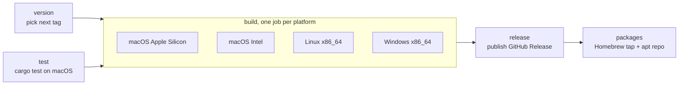

# Releases and CI

Three GitHub Actions workflows live in `.github/workflows/`.

## Releases (`release.yml`)

Runs on every push to `main` that changes Rust code (`src/`,
`Cargo.toml`, `Cargo.lock`, `rust-toolchain.toml` or the workflow itself),
and can be started by hand (*Run workflow*). Docs-only changes don't make a
release.

1. **version** picks the next version. MAJOR.MINOR come from `Cargo.toml`.
   PATCH is one more than the latest `vMAJOR.MINOR.*` tag, starting at 0.
   To start a new series, bump `Cargo.toml` to e.g. `0.2.0` and the next
   release is `v0.2.0`.
2. **test** runs `cargo test --locked`. If tests fail, nothing is built.
3. **build** compiles a release binary per platform and packages it:

    | Platform | Files | How |
    | --- | --- | --- |
    | macOS (arm64, x86_64) | `.dmg` | `Tabula.app` bundle (Info.plist with the version), ad-hoc code signature (required to run on Apple Silicon), then `hdiutil` makes a disk image with an Applications shortcut. |
    | Linux x86_64 | `.deb`, `.tar.gz` | `cargo deb` with the metadata in `Cargo.toml`, which installs `/usr/bin/tabula` and a desktop entry and depends on the Vulkan loader. The tarball holds the binary and README. Built on Ubuntu 22.04 so it runs on older glibc too. |
    | Windows x86_64 | `.msi`, `.exe` | WiX 5 builds the installer from `packaging/windows/tabula.wxs`: per-machine install in Program Files, Start menu shortcut, upgrades replace older versions. The bare `.exe` runs without installing. |

    The build jobs use `fail-fast: false`: one platform failing doesn't
    stop the others.

4. **release** publishes a GitHub Release (`vX.Y.Z`) with every file that
   was built, notes on installing each, and the generated changelog. If
   any expected file is missing, the notes list it.
5. **packages** runs `packages.yml` (below) for the new tag.

Only one release runs at a time (`concurrency: release`), so two pushes
can't claim the same version.

### Not signed yet

- **macOS:** the app is ad-hoc signed but not notarized, so Gatekeeper
  blocks the first launch until it's allowed in System Settings → Privacy &
  Security (Open Anyway). Notarizing needs an Apple Developer ID. The
  Homebrew cask keeps the quarantine flag on and says this in its caveats.
- **Windows:** the `.exe` and `.msi` aren't code-signed, so SmartScreen may
  warn (More info → Run anyway). Signing needs a code-signing certificate.

## Homebrew tap and apt repository (`packages.yml`)

Called by `release.yml` after each release, or run by hand with a tag
(*Run workflow*, e.g. `v0.1.5`) to republish one. Two jobs:

- **homebrew** downloads the two `.dmg` files, writes `Casks/tabula.rb` with
  `packaging/homebrew/cask.sh` (version and both SHA-256s), and pushes it to
  [bhumit070/homebrew-tap](https://github.com/bhumit070/homebrew-tap).
- **apt** downloads the `.deb`, adds it to
  [bhumit070/tabula-apt](https://github.com/bhumit070/tabula-apt) with
  `packaging/apt/update-repo.sh` (keeps the newest 3 versions, rebuilds the
  indexes with `apt-ftparchive` and signs them), and force-pushes a single
  commit so old packages don't pile up in git history. GitHub Pages serves
  that repo as the apt repository.

Secrets in this repository:

| Secret | What |
| --- | --- |
| `HOMEBREW_TAP_DEPLOY_KEY` | SSH key; its public half is a write deploy key on `homebrew-tap` |
| `APT_REPO_DEPLOY_KEY` | SSH key; its public half is a write deploy key on `tabula-apt` |
| `APT_SIGNING_KEY` | Armored private GPG key that signs the apt repository (fingerprint `283C 8944 4C8D ECC2 F353 0F02 8898 FBC0 F87C 21BA`). Its public half is `tabula.gpg` in the apt repo, which users install. Replacing it means every user has to fetch the new key. |

The maintainer's macOS Keychain holds a backup of the signing key
(service `tabula-apt-signing-key`). Keychain returns it hex-encoded:
`security find-generic-password -s tabula-apt-signing-key -w | xxd -r -p`.

To test the scripts locally: `packaging/homebrew/cask.sh VERSION ARM.dmg
INTEL.dmg` prints the cask; `KEY_ID=… packaging/apt/update-repo.sh DIR
tabula.deb` builds a repository in `DIR` (needs `apt-ftparchive`, so run it
on Debian/Ubuntu or in a container).

## Documentation site (`docs.yml`)

Runs on every push to `main` that changes `docs/`, `mkdocs.yml` or the
workflow itself, and by hand.

1. Installs MkDocs Material from `docs/requirements.txt`.
2. `mkdocs build --strict`: broken internal links or a bad config fail the
   build instead of publishing a broken site.
3. Uploads the `site/` folder and deploys it to GitHub Pages:
   <https://bhumit070.github.io/tableplus_rs/>.

GitHub Pages is set to **GitHub Actions** as its source (repository
*Settings → Pages*).
